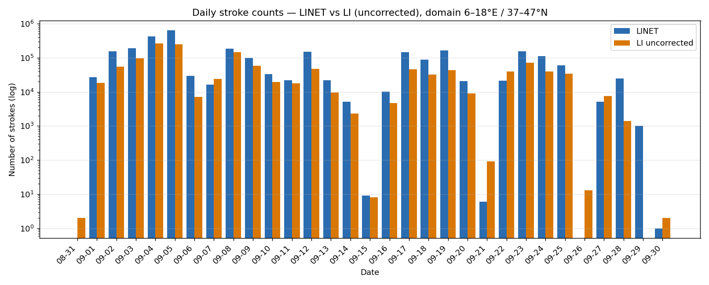
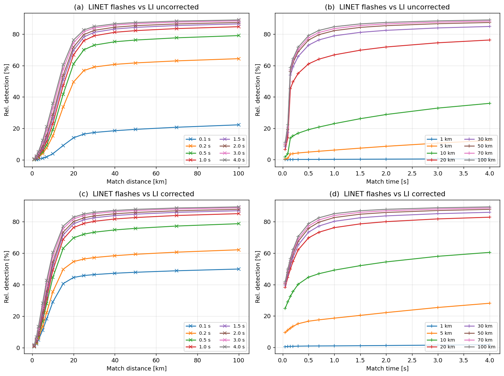

# MTG Lightning Imager vs LINET over Italy

Comparison of space-based lightning observations from the **MTG Lightning Imager (LI)** with the ground-based **LINET** network over Italy and the surrounding seas (6–18°E, 37–47°N), September 2024.

Developed during a research internship at **CNR-ISAC** (Institute of Atmospheric Sciences and Climate, National Research Council of Italy), Rome, May–July 2026.

## Motivation

The Lightning Imager on Meteosat Third Generation is the first geostationary lightning sensor covering Europe and Africa. Before its data can be used, for example to evaluate or constrain lightning in numerical weather prediction models, it has to be checked against an independent reference. LINET, a VLF/LF ground network, detects individual return strokes with high location accuracy over Europe. This project asks:

- Do the two systems see the same storms at the same times?
- What fraction of LINET events has an LI counterpart (relative detection efficiency), and how does it depend on the matching window?
- Is there a systematic spatial offset between LI and LINET? Before parallax correction, LI positions are expected to be shifted away from the sub-satellite point, because the sensor sees the top of the cloud, not its ground projection.

## Data

| Source | What one record is | Notes |
|---|---|---|
| LINET strokes | One return stroke | Commercial data (nowcast GmbH), **not included** |
| LINET flashes | Strokes grouped into flashes | Provided by CNR-ISAC, **not included** |
| MTG-LI groups, uncorrected | One LI group, position as seen by the satellite | Available from the [EUMETSAT Data Store](https://data.eumetsat.int), converted to text |
| MTG-LI groups, corrected | The same groups after parallax correction | Correction done with an existing algorithm, not part of this repository |

All inputs share one plain-text format, one event per line:

```
lon lat YYYYMMDD HH:MM:SS.fff
```

## Methods

**Consistency checks** (`plot_histograms.py`): daily counts, hourly counts per day, and the diurnal cycle for every source. If the curves peak at different hours, that points to a timezone or data problem.

**Event matching** (`match_strokes.py`): for each event in dataset A, find the spatially nearest event in dataset B within a time window of ±Δt and a distance of Δr (great-circle distance). Candidates are found via a sorted time search, so a month of data runs in seconds. The output keeps the signed time offset and the longitude/latitude shift of every matched pair. These show systematic biases such as parallax.

**Detection efficiency curves**: the matching is repeated over a grid of Δt (0.1–4 s) and Δr (1–100 km) to show how the relative detection efficiency depends on the window. This makes it possible to choose thresholds from the data instead of fixing them a priori.

## Results

### Event counts



LI follows the day-to-day variability of LINET over four orders of magnitude, from almost inactive days to the 4–5 September peak (≈430,000 and ≈630,000 LINET events per day). On most active days LINET records about 1.5–4 times more events than LI. The two systems count different things: individual strokes detected on the ground versus optical groups seen from orbit.

### Matching at a reference window (±1 s, ≤20 km)

998,706 LINET flashes, September 2024. Δt and Δlon/Δlat are LI − LINET.

| | LI uncorrected | LI corrected |
|---|---:|---:|
| Matched flashes | 667,076 | 760,692 |
| Relative DE | 66.8% | 76.2% |
| Median distance | 12.2 km | 8.1 km |
| 90th percentile distance | 17.9 km | 14.9 km |
| Median signed Δt | +125 ms | 0 ms |
| Median Δlon | +0.074° (≈6 km E) | +0.045° (≈4 km E) |
| Median Δlat | +0.066° (≈7 km N) | −0.004° (≈0 km) |

- **Parallax correction raises DE from 66.8% to 76.2%** and reduces the median LI–LINET distance from 12.2 to 8.1 km.
- **Before correction, LI positions are shifted to the north-east** by about 9–10 km. This is the expected direction: away from the sub-satellite point at 0°N, 0°E, because the sensor sees the top of the cloud, not the ground below it.
- **After correction the north–south offset disappears, but a residual eastward shift of about 4 km remains.**

### Detection efficiency vs matching window



- **With a loose window** (Δt ≥ 1 s, Δr ≥ 50 km), about 85–89% of LINET flashes have an LI counterpart, both before and after parallax correction.
- **Parallax correction matters mainly at tight distance thresholds.** At Δt = 1 s and Δr = 10 km, DE roughly doubles (≈23% → ≈49%).
- **After correction the curves saturate at ≈15–20 km instead of ≈25–30 km.**
- **In time, DE saturates within ≈0.5–1 s.**

### Known issue: time offset in the uncorrected LI files

Uncorrected LI groups are on average 125 ms later than LINET, while corrected groups show no offset. Parallax correction only changes positions, so this offset comes from how the uncorrected files were produced, not from the physics. It explains the low DE of the uncorrected data at Δt ≤ 0.1–0.15 s (panels a and b). At Δt = 1 s, the effect on DE is small.

## Repository structure

| File | Contents |
|---|---|
| `data_io.py` | Reading, domain filtering and concatenation of daily files |
| `plot_histograms.py` | Daily, hourly and diurnal histograms for any number of sources |
| `match_strokes.py` | Nearest-neighbour space–time matching, summary metrics, threshold sweeps, DE curves |
| `01_counts_and_diurnal_cycle.ipynb` | Loads the sources, runs the consistency checks and zooms into single days |
| `02_matching.ipynb` | Space–time matching of LINET flashes with uncorrected and corrected LI, summary table at a reference window, threshold sweeps and detection-efficiency curves |
| `results/` | Cached sweep tables and matching summary (created by `02_matching.ipynb`) |
| `figures/` | Selected output figures |

## Usage

```bash
pip install -r requirements.txt
```

The data are expected **next to** the repository, not inside it:

```
parent/
├── mtg-li-linet-comparison/   <- this repo
├── linet_data/
└── LI_september/daily/
```

If your data are somewhere else, change `LINET_DIR` and `LI_DIR` at the top of each notebook. Then run the notebooks in order. The threshold sweep in `02_matching.ipynb` is the slow step; its results are cached in `results/`, so the detection-efficiency figure can be rebuilt without the raw data. The plotting and matching functions take a dict `{label: DataFrame}`, so a new source (for example parallax-corrected LI) only needs one extra entry.

```python
from data_io import read_strokes_dir, DOMAIN
from match_strokes import match_nearest, matching_summary

linet = read_strokes_dir("linet_data", pattern="LinetStrokesData*.txt", domain=DOMAIN)
li    = read_strokes_dir("LI_september/daily", pattern="*_uncorrected*.txt", domain=DOMAIN)

matches = match_nearest(linet, li, dt_max_ms=200, dr_max_km=20)
matching_summary(matches, "LINET", "LI")
```

## Acknowledgements

Thanks to Stefano Federico and CNR-ISAC for hosting the internship and providing the LINET data.
